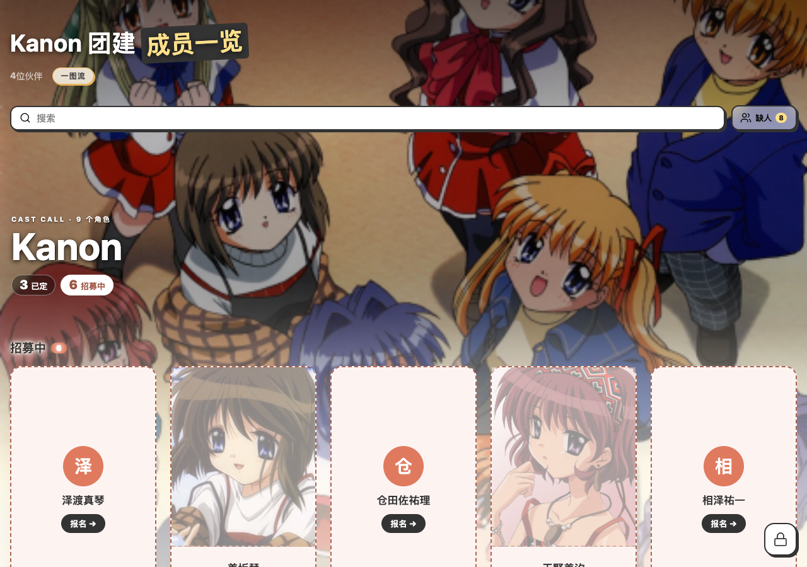
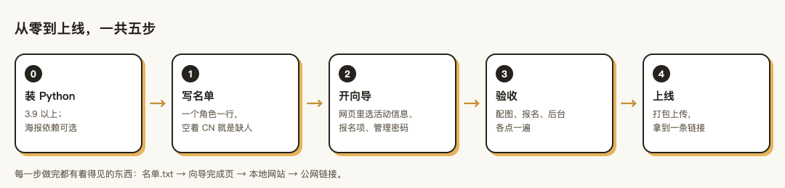

# castcall

**cos 团建 / 团片招募用的名册站。** 一个页面看清「哪个团、哪个角色、谁来出」，空着的角色可以在线报名，团长在后台审核通过后才落座。

> **0.1.0-beta** · 第一个公开版本。功能是完整的，但 0.1 阶段接口和数据结构仍可能调整——升级前备份 `instance/`，你的名册、报名、图片全在里面。

## 最快：一句话让 AI 帮你部署

**推荐用 [WorkBuddy](https://www.workbuddy.cn)**：它自带「发布为应用」，说一句「发布」就能把站推到公网、拿到分享链接，不用自己找托管平台、也不用买服务器。搭这种只用 Python 标准库的小站，比自己租一台云主机省事也省钱。

打开 WorkBuddy，把仓库目录加进工作区（或者直接说「clone 这个仓库」），然后说这一句：

> 用 castcall 把这份名单做成招募页：配好图、生成一图流，建好后把链接给我，并告诉我配上了几张、哪几个没配上。名单：……

它会读仓库里的 [AGENTS.md](AGENTS.md)，自己装环境、逐个核对角色名对不对得上作品角色表、建站、找封面和立绘、出三种版式的海报、逐项验收；要上线再加一句「发布，把分享链接给我」。

| AI 自己会做 | 必须你拍板（它不会替你编） |
|---|---|
| 检查 Python 版本、装可选的海报依赖 | 名单里的人名和 CN |
| 把名单整理成格式、逐个核对名字对不对得上作品角色表 | 活动日期、开场时间、地点、咨询方式——**你没说就留空** |
| 启动服务、给你验证码和向导链接、按你选的建站 | 报名表还要不要问身高 / 样片这类额外题目 |
| 自动找封面和立绘、生成三种版式的一图流 | 管理密码（自己在向导里设，或让它随机生成后转告你） |
| 逐项验收、汇报配了几张 / 缺几张 | **要不要上线**：只有你明确说「发布 / 要分享链接」它才会做 |
| 打包、发布、逐端点验收、配好代理真实 IP 头 | 重新发布会覆盖线上报名，这个决定要你点头 |

**怎么知道它没糊弄你**：别只信一句「建好了」，让它给出三样看得见的东西——① `instance/roster.json` 里团 / 角色 / CN 和你的名单一致；② 完成页那行「立绘 N 张」等于可配图的角色数（工作组不算）；③ 打开链接把[验收四件事](docs/walkthrough.md#第-5-步验收四件事点一遍)点一遍，上线的话再让它报一次 `/api/health` 的返回。项目里 `tools/lab.py check` 就是干这个的：**断言全在外部做**（读文件、发 HTTP），不听 AI 自述。

用 Claude Code / Codex / Cursor 也一样，建站、配图、出海报都做得了；区别只在上线那一步——这些工具没有托管能力，得你自己找平台发布，见 [docs/hosting.md](docs/hosting.md)。

不想用 AI 也行，自己走一遍十几分钟：[五条命令](#自己动手五条命令)，细节看[图文手册](docs/walkthrough.md)。

---

## 它是什么

- **只用 Python 标准库**：`python3 server/server.py` 就能跑，前端没有构建步骤，也不用装数据库。
- **单团 / 多团自动切换**：一部作品就是一整页阵容；好几部作品自动变成封面卡墙。
- **数据全在你自己手里**：名册是 `instance/roster.json`，报名在 `instance/castcall.db`（sqlite），没有第三方账号。
- **一图流海报**：建站时自动把名册排成一张长图，网页版能看、能导出 JPG（可选依赖，不装也不影响建站）。



*单团页：顶部是封面，下面「招募中」的席位可以直接点「报名 →」，右下角的锁是后台入口。*

## 全流程



**装环境 → 写名单 → 向导建站 → 验收 → 要发链接才上线。** 每一步都有看得见的东西：`名单.txt` → 终端里的六位验证码 → 向导完成页 → 本地网站 → 公网链接。

## 自己动手：五条命令

```bash
# 0. 只要 Python 3.9+；核心服务不装任何依赖
git clone https://github.com/RichardLiuda/castcall.git && cd castcall

# 1. 写一份 名单.txt（一行一个角色 + CN；没有 CN = 空缺）
#    「## 团名」分团，「>」写团说明，团名带「摄影 / 后勤」会当工作组

# 2. 建站前核对名字配不配得上图（不下载、不建站）
python3 server/artsearch.py names 名单.txt

# 3. 启动，终端会打印 6 位验证码和一个带它的链接
python3 server/server.py --prefill 名单.txt --title "Kanon 团建"

# 4. 在浏览器里打开那个链接，向导里核对名单、填活动信息、设管理密码
# 5. 按验收清单点一遍：名册对、图在、报名能点、后台进得去
```

海报要额外装（不装也能建站，只是跳过海报）：

```bash
python3 -m venv .venv-poster && .venv-poster/bin/pip install -r requirements-poster.txt && .venv-poster/bin/playwright install chromium
```

每一屏长什么样、每一格填什么、不填会怎样：[**docs/walkthrough.md**](docs/walkthrough.md)。只要命令清单：[docs/quickstart.md](docs/quickstart.md)。

**没有浏览器**（只能 ssh 的服务器）、或者想一次批量建站：走命令行，效果和向导相同：

```bash
python3 init.py --title "Kanon 团建" --import 名单.txt --fields "身高,样片*,性别" --yes
python3 server/server.py
```

`*` 结尾表示必填；不给 `--password` 会随机生成一个密码，只打印一次。`init.py` 不带参数是一问一答。

## 常见卡点

| 症状 | 多半是 | 怎么办 |
|---|---|---|
| 打开 `127.0.0.1:5510` 连不上 | 启动服务的终端被关了 | 回到上面第 3 条重新运行 |
| 向导停在「验证码」 | 没带 `?t=`，或六位数输错 | 输终端里那 6 位；连错太多锁 10 分钟，重启服务器换一个 |
| 配图少了几张 | 断网，或角色名是日文 / 假名写法 | 后台「找立绘」手选，或网络好了点「一键配图」 |
| 改了名单，海报还是旧的 | 海报不会自动重建 | 后台点「生成一图流」，按钮带「旧」字就是提醒 |

完整清单（症状 → 原因 → 办法）：[docs/troubleshooting.md](docs/troubleshooting.md)。

## 文档

| 文档 | 讲什么 |
|---|---|
| [docs/walkthrough.md](docs/walkthrough.md) | **图文手册**：从装环境到上线，每一步带真实截图 |
| [docs/quickstart.md](docs/quickstart.md) | 同一套流程的命令版，参数更全 |
| [docs/admin.md](docs/admin.md) | 建好之后日常改东西：名单、图片、审核、报名字段、招募须知 |
| [docs/config.md](docs/config.md) | `site.json` 每个字段、名单格式、单团 / 多团怎么切 |
| [docs/poster.md](docs/poster.md) | 一图流版式、字体、可选依赖 |
| [docs/data.md](docs/data.md) | 数据在哪、备份、换机器、线上和本地两份数据 |
| [docs/hosting.md](docs/hosting.md) | 发布到托管平台（WorkBuddy / Docker / PaaS） |
| [docs/deploy.md](docs/deploy.md) | 自己的服务器：systemd + 反向代理 |
| [docs/notion.md](docs/notion.md) | 接 Notion 同步报名和名册 |
| [docs/troubleshooting.md](docs/troubleshooting.md) | 卡住了怎么办 |
| [TODO.md](TODO.md) | 想清楚了还没做的，以及明确不做的事（附理由） |
| [docs/optimization-log.md](docs/optimization-log.md) | 为什么这么改：每轮优化的判断、坑和验证结果 |
| [AGENTS.md](AGENTS.md) / [skills/](skills/) | 给 AI 助手看的操作手册（标准流程 + 禁区）和两个可安装技能 |

## 目录

```
server/    HTTP 服务、名册保存链路、sqlite、Notion 适配器
web/       前端（原生 HTML/CSS/JS，无构建步骤）
poster/    一图流生成脚本
tools/     打包、体检、验收脚本
examples/  示例配置和名册
docs/      文档 + 截图（docs/images/）
tests/     python3 -m unittest discover -s tests
instance/  ← 你的数据（建站时生成，已在 .gitignore 里，不要提交）
```

## 许可证

代码以 [MIT](LICENSE) 发布。**许可证不覆盖任何图片和素材**：你上传的封面、立绘、logo 版权归各自的权利人，仓库里也不附带任何第三方素材。

castcall 从一个真实活动的名册站（keyroster）里抽出来，去掉了活动专属的内容和数据。
