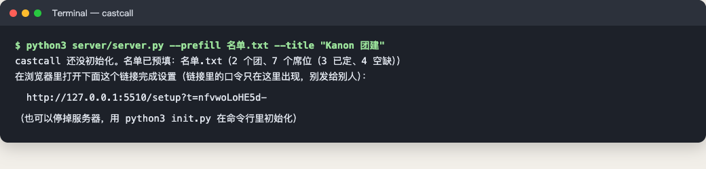
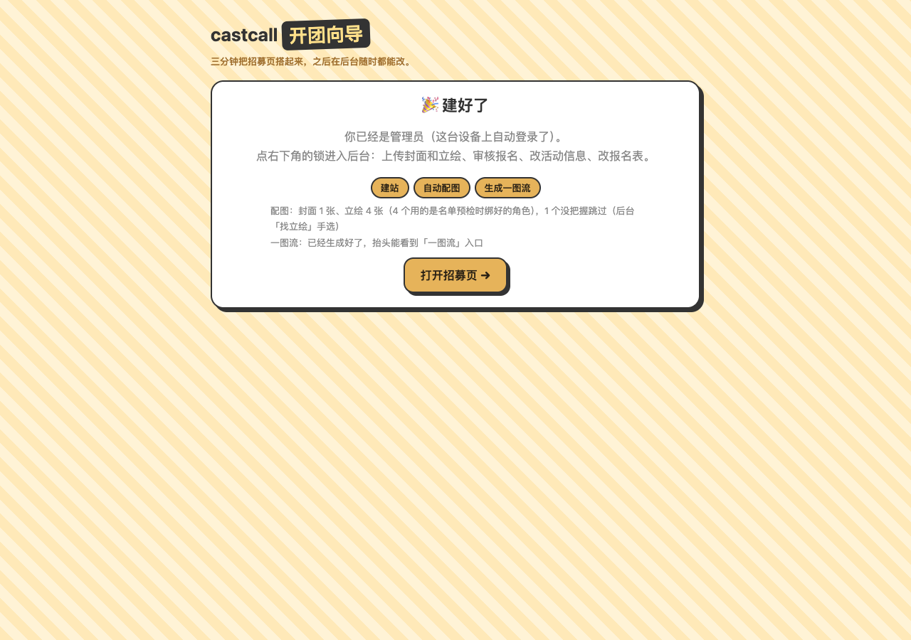
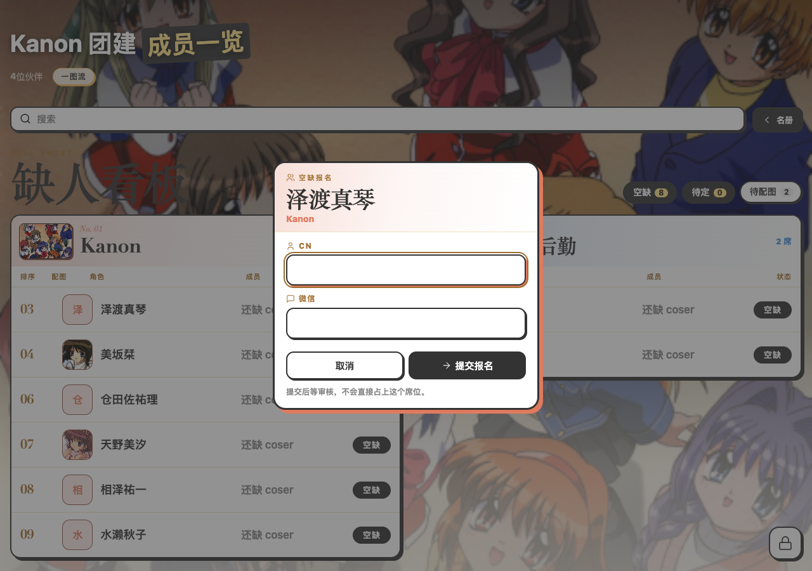
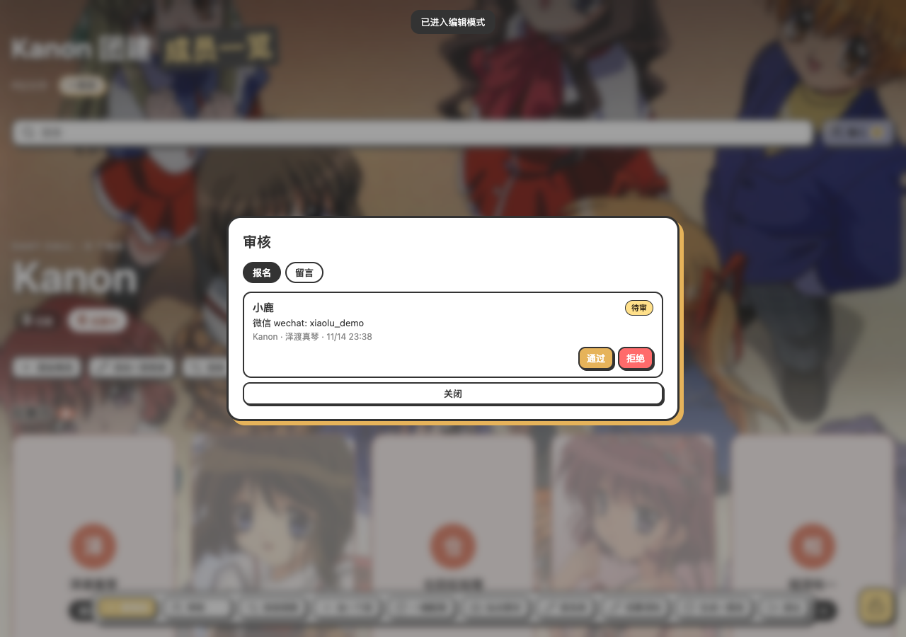
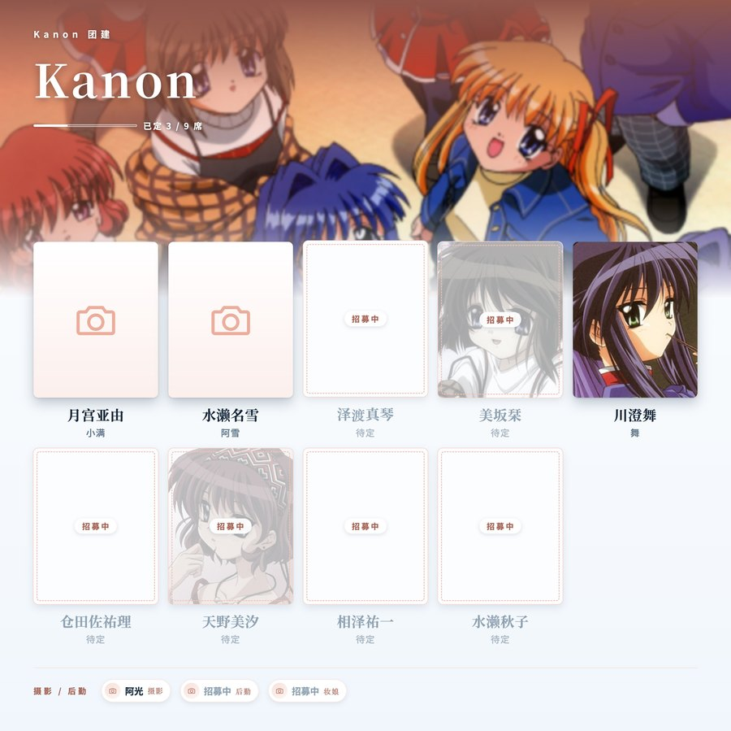
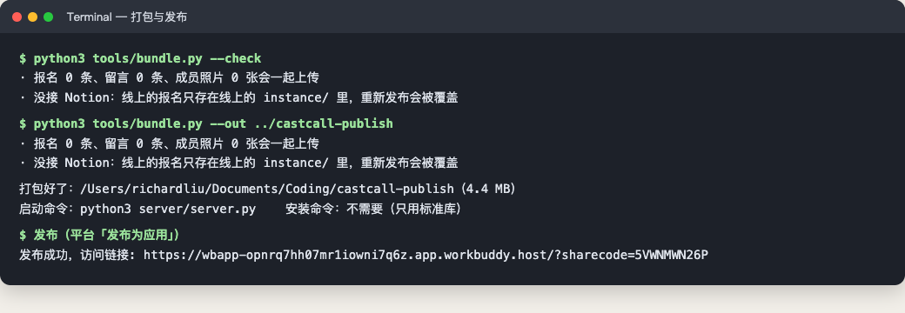
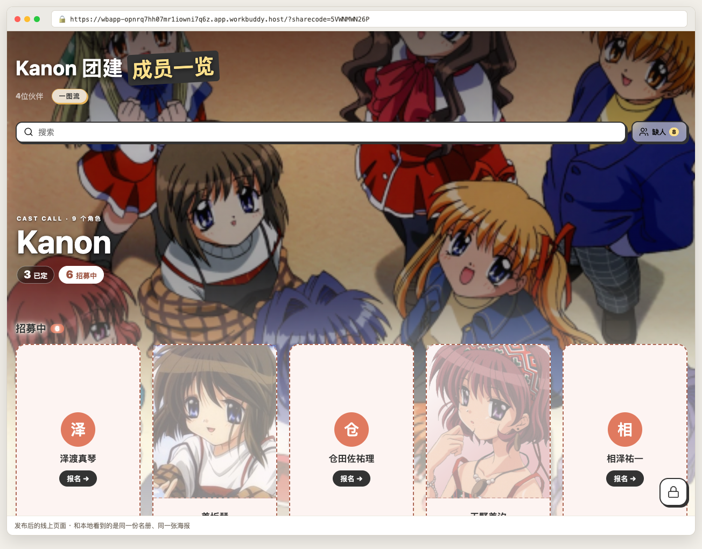

# castcall

**cos 团建 / 团片招募用的名册站。** 一个页面看清「哪个团、哪个角色、谁来出」，空着的角色可以在线报名，团长在后台审核通过后才落座。

> **0.1.0-beta** · 第一个公开版本。功能是完整的，但 0.1 阶段接口和数据结构仍可能调整——升级前备份 `instance/`，你的名册、报名、图片全在里面。

- **只用 Python 标准库**：`python3 server/server.py` 就能跑，前端没有构建步骤，也不用装数据库。
- **单团 / 多团自动切换**：一部作品就是一整页阵容；好几部作品自动变成封面卡墙。
- **数据全在你自己手里**：名册是 `instance/roster.json`，报名在 `instance/castcall.db`（sqlite），没有第三方账号。
- **一图流海报**：建站时自动把名册排成一张长图，网页版能看、能导出 JPG（可选依赖，不装也不影响建站）。

下面是建好之后的样子：


*图 1 · 单团页：顶部是封面，下面「招募中」的席位可以直接点「报名 →」，右下角的锁是后台入口。*

---

## 先看全流程


整件事就是五步。每一步做完都有看得见的东西：**名单.txt → 向导完成页 → 本地网站 → 公网链接**。第一次自己动手，照着走大概十几分钟；后面改名单、改图片都在网页后台点，不用再碰命令行。

> **但更省事的是：下面这些步骤基本上都能让 AI 跑完。** 你只要给一份名单，说一句「用 castcall 帮我搭招募页」，装环境、核对名字、启动服务、配图、出海报、验收、打包上线都由它做；你只在向导里填只有你知道的那几项。下面这份手把手教程，主要是留给你**看懂它在做什么、检查它做得对不对**的。详见[最省事的做法](#最省事的做法整件事交给-ai)。

---

## 最省事的做法：整件事交给 AI

**这个仓库本来就是按「AI 助手来跑」设计的。** 根目录的 [AGENTS.md](AGENTS.md) 是写给 AI 的操作手册：标准流程、每一步的命令、名单格式、还有一整节「不要做」；`skills/` 里另有建站和发布两个可直接安装的技能。AI 拿到仓库会先读这些，下面这些步骤里绝大多数命令你都不用自己敲。

**一句话起步**（把名单粘在后面，或只给作品名让它整理一版）：

> 用 castcall 帮我把这份名单做成招募页，配好图、生成一图流；建好后把链接给我，并告诉我配上了几张、哪几个没配上。名单：……

名单给文字、表格、CSV，甚至群聊截图都行（看不清的 CN 它会留空问你，不会猜）。

| AI 自己会做 | 必须你拍板（它不会替你编） |
|---|---|
| 检查 Python 版本、装可选的海报依赖 | 名单里的人名和 CN |
| 把名单整理成格式、逐个核对名字对不对得上作品角色表 | 活动日期、开场时间、地点、咨询方式——**你没说就留空** |
| 启动服务、给你带口令的向导链接、按你选的建站 | 报名表还要不要问身高 / 样片这类额外题目 |
| 自动找封面和立绘、生成三种版式的一图流 | 管理密码（自己在向导里设，或让它随机生成后转告你） |
| 逐项验收、汇报配了几张 / 缺几张 | **要不要上线**：只有你明确说「发布 / 要分享链接」它才会做 |
| 打包、发布、逐端点验收、配好代理真实 IP 头 | 重新发布会覆盖线上报名，这个决定要你点头 |

连向导都不想点，可以明说「不用给我向导，你全权处理」：它会走命令行一次做完（`init.py`），但**不会替你编活动信息**——日期、地点、报名字段一律留空，密码随机生成后把打印出来的那一串原样转告你。

**怎么知道它没糊弄你**：别只信一句「建好了」，让它给出三样看得见的东西——① `instance/roster.json` 里团 / 角色 / CN 和你的名单一致；② 完成页那行「立绘 N 张」等于可配图的角色数（工作组不算）；③ 打开链接把[第 5 步](#第-5-步验收四件事点一遍)那四项点一遍，上线的话再让它报一次 `/api/health` 的返回。项目里 `tools/lab.py check` 就是干这个的：**断言全在外部做**（读文件、发 HTTP），不听 AI 自述；`blind` 还会派一个完全不知情的新助手按文档走一遍，看这套说明本身够不够用。

> AI 拿不准的仍然要人看一眼：名字是日文写法或假名改写时，它会列出来给你确认，不会自己改字；配不上的立绘宁可空着，也不乱猜一张贴上去。

---

## 第 0 步：装环境

只要 **Python 3.9 以上**。打开终端，先确认一下：

```bash
python3 --version          # 看到 Python 3.9.x 以上就行
git clone https://github.com/RichardLiuda/castcall.git
cd castcall
```

macOS / Linux / Windows 都可以。核心服务**不需要 pip install 任何东西**。

只有「一图流海报」用到两个额外依赖，建议装上（不装也能建站，只是跳过海报，以后补装再点一次「生成一图流」即可）：

```bash
python3 -m venv .venv-poster
.venv-poster/bin/pip install -r requirements-poster.txt
.venv-poster/bin/playwright install chromium
# Linux 服务器还要中文字体：sudo apt install fonts-noto-cjk
```

仓库里有 `.venv-poster/` 就会被自动使用，不用改配置。Windows 上把 `.venv-poster/bin/` 换成 `.venv-poster/Scripts/`。

---

## 第 1 步：写一份名单

新建一个 `名单.txt`，**一行一个角色**，前面写角色名，后面写已经定下来的 CN；**只有角色名没有 CN 的，就是还在招募的空位**：

```
## Kanon                      ← 一个「##」开一个团；只有一部作品也建议写
> 光坂外景，妆造自理          ← 「>」开头是这团的说明
月宫亚由 云果                 ← 角色 + CN（空格 / Tab / 冒号 / 竖线分隔都行）
泽渡真琴 小满
美坂栞                       ← 没有 CN = 空缺，可以报名
川澄舞
## 摄影 / 后勤                ← 团名带「摄影 / 后勤 / 妆娘 / staff」会当工作组，不配立绘
摄影 阿光
后勤                         ← 工作组里也能留空位招人
```

名单从哪来，三选一：

| 你手上有 | 怎么做 |
|---|---|
| 群公告 / 表格 / Excel | 按上面的格式粘贴成文本；CSV 也行，表头写 `团,角色,CN` |
| 只有作品名 | `python3 server/artsearch.py roster Kanon -o 名单.txt`，拉一份该作品的角色表（全空缺）再改 |
| 还没想好 | 不用准备文件，向导里选「先空着」，建好后在后台一个个加 |

**建站前建议先核一次名字**（不下载图片、不建站，只是看看角色名在作品角色表里对不对得上）：

```bash
python3 server/artsearch.py names 名单.txt
```

每个名字后面会跟一个标记：`✓` 能配上图；`⚠` 只差一个字，多半是写错了；`✗` 作品里没这个名字，下面会列出候选。**这一步能提前发现「月宫亚由」写成「月宮あゆ」这类问题**——建完站才发现，就得去后台一张张手选了。核对过的名字会存成角色 id，后面配图不再靠搜索碰运气。

---

## 第 2 步：启动，拿到向导链接

在仓库目录里执行（`--title` 里的活动名换成你自己的）：

```bash
python3 server/server.py --prefill 名单.txt --title "Kanon 团建"
```

终端会打印这样一段：



*图 2 · 真实终端输出。那串 `?t=…` 是本次建站的口令，只在这里出现。*

**把 `http://127.0.0.1:5510/setup?t=…` 这一整条复制到浏览器打开**。注意三点：

1. 链接必须带 `?t=` 后面那串口令，只开 `127.0.0.1:5510` 会进不了向导。
2. 口令不要发给别人——谁先打开谁就能设管理密码。
3. **这个终端窗口先别关**，关了服务就停了；向导填到一半被关掉，用同一条命令重启，链接不变，可以接着填。

没有名单的话，直接 `python3 server/server.py`，在向导里粘贴名单或选「先空着」也一样。

---

## 第 3 步：在网页向导里填五项

打开链接后是这张表，**名单和活动名已经替你填好了**，核对一下就行：


*图 3 · 向导第 1～3 步。往下滚动还有「报名要填什么」和「管理密码」。*


*图 4 · 向导第 4～5 步，最下面那个深色按钮就是「建好它 →」。*

逐个说明每一项该填什么、不填会怎样：

| 位置 | 填什么 | 不填 / 选错会怎样 |
|---|---|---|
| **1 招募什么** | 单团团片 / 多团团建。名单只有一个团时默认「单团」 | 选错了也能在后台改；单团是整页阵容，多团是封面卡墙 |
| **2 活动名称** | 显示在页眉和海报上，比如「Kanon 团建」 | 必填 |
| **2 日期 / 开场时间** | 填了开场时间，页面顶部会出现倒计时 | 留空就完全不显示这一段（**不会替你编一个日期**） |
| **2 地点 / 咨询联系方式** | 显示在缺人看板上，方便路人问 | 留空就不显示，别填没确定的信息 |
| **2 报名联系方式** | 报名表里那一栏叫什么：微信 / QQ / 邮箱 / 手机号 | 只影响表头文字 |
| **3 角色名单** | 直接在框里改；下方实时显示「几个团、几个席位、几个空缺」 | 改错了随时回来改，后台也能增删改 |
| **3 检查名字** | 点一下，去作品角色表逐个核对 | 断网也能建站，只是配图可能少几张 |
| **4 报名要填什么** | 勾身高 / 年龄 / 性别 / 样片 / 所在城市…，每项选「选填」或「必填」，也能自己出题 | CN 和联系方式固定要填；其余不勾就不会出现在报名表 |
| **5 管理密码** | 至少 8 位，输两遍 | **记牢**：右下角的锁靠它进后台；忘了可以在服务器上跑 `python3 init.py --force` 重设 |

> 只是想先看看效果？向导第 3 步里有个「只是想先看看效果？用示例数据」，展开选一份即可，不用自己写名单。

确认无误，点最下面的 **「建好它 →」**。

---

## 第 4 步：看完成页

提交后页面变成这样，三个格子会依次亮起来：



*图 5 · 三格全亮 = 全做完了。下面两行小字是配图和一图流的结果。*

| 格子 | 做了什么 | 没成功怎么办 |
|---|---|---|
| **建站** | 写出 `instance/` 下的名册、配置、密码 | 失败会在按钮下方红字说明原因 |
| **自动配图** | 给每个团找封面、给每个角色找立绘；只配有把握的，其余跳过 | 断网 / 名字对不上会跳过几个，页面写清原因；进后台点「找立绘」手选，或「一键配图」重试 |
| **生成一图流** | 生成网页版海报 + JPG | 没装第 0 步的可选依赖会跳过；装好后在后台点「生成一图流」补上 |

**配图和海报失败都不会让建站失败**，网站已经能用了。完成后这台设备会自动登录成管理员，点「打开招募页 →」就能看。

> 海报是后台慢慢生成的，完成页会继续等它落盘（一两分钟）。三格全亮才算真的好了；如果等太久，去 `instance/logs/poster.log` 看一眼。

---

## 第 5 步：验收，四件事点一遍

服务已经在跑，打开 **http://127.0.0.1:5510/**（就是本文第一张图）。照着这份清单点：

1. **名册对不对**：团名、角色、CN 和你写的名单一致；一部作品 + 摄影后勤应该是一整页，不是两张卡。
2. **图片在不在**：封面、立绘配上了；页眉有「一图流」入口（没装可选依赖的话没有）。
3. **报名能不能点**：空缺角色上点「报名 →」，能打开报名表。
4. **后台进不进得去**：点右下角的锁，输刚才设的密码，能看到编辑工具条。

页面上还有这些现成的东西：搜索框（按角色或 CN 找人）、「缺人」看板（所有空位按团列出）、留言区、倒计时（填了开场时间才有）、成员照片（可选，审核后显示在角色卡上）。

---

## 第 6 步：报名和审核是怎么走的

访客在空缺席位上点「报名 →」，填 CN 和联系方式（以及你勾过的额外题目）：



*图 6 · 提交后会提示「已提交，等审核」——**不会直接占座**。*

团长这边点右下角的锁 → 工具条「审核」→「报名」，就能看到待审的那条：



*图 7 · 点「通过」才会把 CN 写进名册、占掉那个席位；点「拒绝」则保持空缺。*

这样做的好处：别人填错、灌水、一个人报好几个角色，都由你把关。留言区也能设成「先审后发」，同一套面板里切到「留言」页签即可。

---

## 第 7 步：后台还能改什么

进入编辑模式后，页面底部会出现一整排工具按钮：


*图 8 · 从左往右：新角色、审核、连线视图、加团、一键配图、站点素材、报名表、招募须知、生成一图流、退出。*

| 按钮 | 用来干什么 |
|---|---|
| **新角色 / 加一个团** | 名单不用回到命令行改，直接在这里加 |
| **审核** | 报名、留言、成员照片的通过 / 拒绝 |
| **一键配图** | 批量重试没配上的封面和立绘 |
| **站点素材** | logo、标签页图标、一图流大图，见下图 |
| **报名表 / 招募须知** | 改报名字段、写招募要求（会显示在报名表和缺人看板） |
| **生成一图流** | 名册或图片改过之后重新出海报（不会自动重建） |
| **退出** | 退出编辑模式，页面回到访客视角 |

「站点素材」面板长这样：


*图 9 · 不传图标也会按团名首字自动画一个（图里那个 K）。传过的图会立刻替换，一图流大图换完要重新生成海报。*

没配上立绘的角色：点开角色卡 →「找立绘」→ 从候选里挑一张，或直接上传自己的图。**宁可空着，也不配错图**：拿不准的名字系统不会乱猜，会列出来给人点。

---

## 第 8 步：一图流海报

页眉的「一图流」入口打开的是网页版海报，右上角有「导出图片」：


*图 10 · 手机上会自动挑竖版，电脑上挑横版，同一个地址。*

导出/生成出来的 JPG 长这样（单团阵容版）：



*图 11 · 已定的角色显示立绘和 CN，招募中的留虚线框，最下面一行是工作组。*

三种版式分别对应：`master`（发群 / 投屏）、`portrait`（手机竖屏）、`social`（社交平台配图），都在 `instance/poster/` 里。详细参数和排错见 [docs/poster.md](docs/poster.md)。

---

## 第 9 步：发布到线上

> 这一步只在你想把链接发给别人时做。本地 `http://127.0.0.1:5510/` 只有你自己能看到。

先在**自己电脑上**把站建好、海报生成好（托管平台一般没有 Chrome，生成不了海报），然后打包：

```bash
python3 tools/bundle.py --check                     # 体检：缺什么、会带上去什么
python3 tools/bundle.py --out ../castcall-publish  # 打包到固定目录
```

打包只拷运行需要的代码和 `instance/` 数据，不带 `.venv-poster/`、`.git`、测试和日志。真实输出长这样：



*图 12 · 打包命令 + 平台返回的分享链接。*

再把 `../castcall-publish` 这个目录交给托管平台（Docker、PaaS，或 AI 助手的「发布为应用」），按下面填：

| 项 | 值 |
|---|---|
| 语言 / 运行时 | Python 3.9+ |
| 安装命令 | **留空**（只用标准库） |
| 启动命令 | `python3 server/server.py` |
| 健康检查 | `GET /api/health` → `{"ok": true, "version": "0.1.0-beta"}` |

平台只给一个 `PORT` 环境变量，castcall 会自动监听它并绑 `0.0.0.0`，不用改代码。发布完打开链接核对一次：



*图 13 · 打开分享链接就能看到和本地一样的招募页。*

**上线前必须知道的四件事：**

1. **重新发布会整个覆盖线上的 `instance/`**——开募以后再发布，线上收到的报名、留言、审核记录都会没。要长期招募，选一种：接 [Notion](docs/notion.md) 同步、只在开募前发布一次、或者定期把线上 `instance/` 拉回来备份。
2. **管理密码跟着打包上去**，就是你在向导里设的那个。忘了在线上没法自助找回。
3. **平台上不能重新生成一图流**（没有 Chromium），已有的海报照常能看。改了名册要更新海报，在本地生成后重新打包发布。
4. **频率限制要配一次**：上线后登录后台打开 `/api/admin/whoami`，看平台用哪个头传真实 IP，把它写进 `.env`（例如 `CASTCALL_TRUST_PROXY=X-Real-IP`）再发布一次。不配的话全站访客共用一份限制，10 分钟一共只能报名 8 次。详见 [docs/hosting.md](docs/hosting.md)。

发布目录**固定用同一个**（`../castcall-publish`），换目录会被当成新应用、链接也变了。下线、重新发布、备份的完整说明见 [docs/hosting.md](docs/hosting.md)；自己的服务器用 systemd + nginx 的话看 [docs/deploy.md](docs/deploy.md)。

---

## 常见卡点

| 症状 | 多半是 | 怎么办 |
|---|---|---|
| 打开 `127.0.0.1:5510` 没反应 / 连不上 | 启动服务的终端窗口被关了 | 回到第 2 步重新运行那条命令 |
| 向导说「名单是空的」 | 名单框里没内容，又选了「粘贴名单」 | 粘名单，或改选「先空着」 |
| 向导说「缺少口令」 | 只复制了域名，漏了 `?t=…` | 用终端打印的**整条**链接 |
| 配图少了几张 / 名字对不上 | 断网，或角色名是日文写法、假名改写 | 看完成页的提示；后台「找立绘」手选，或网络好了点「一键配图」 |
| 没有「一图流」入口 | 没装第 0 步的可选依赖，或海报还在后台生成 | 装依赖后进后台点「生成一图流」；看 `instance/logs/poster.log` |
| 改了名单，海报还是旧的 | 海报不会自动重建 | 后台点「生成一图流」，按钮上带「旧」字就是提醒 |
| 线上报名提交了，本地后台看不到 | 线上和本地是两份数据库 | 去**线上**的后台「审核」里看 |
| 线上所有人一起被限制次数 | 没配代理真实 IP 头 | 见第 9 步第 4 条 |

更多「症状 → 原因 → 办法」见 [docs/troubleshooting.md](docs/troubleshooting.md)。

---

## 数据在哪、怎么备份

建站生成的东西**全在 `instance/` 里**（已在 `.gitignore`，不会被提交）：

| 文件 | 是什么 |
|---|---|
| `site.json` | 活动信息和各种开关，手改后刷新页面就生效 |
| `roster.json` | 名册，网页保存会改它 |
| `castcall.db` | 报名、留言、变更记录（sqlite） |
| `auth.json` | 管理密码的哈希 |
| `uploads/` | 上传的封面、立绘、logo |
| `poster/` | 一图流的网页和 JPG |
| `backups/` | 每次保存前的名册快照（默认留最近 300 份） |

**备份 `instance/` 这一个目录就够了。** 更新代码直接 `git pull`，数据不会被动到。

## 没有浏览器：命令行一次做完

只能 ssh 的服务器、想批量建站，或者你让 AI 全权代办（见[最省事的做法](#最省事的做法整件事交给-ai)）时，走命令行，效果和向导相同：

```bash
python3 init.py --title "Kanon 团建" --import 名单.txt --fields "身高,样片*,性别" --yes
python3 server/server.py
```

`*` 结尾表示必填；不给 `--password` 会随机生成一个密码，**只打印一次**。不想自动配图 / 生成海报就加 `--no-art` / `--no-poster`。`init.py` 不带参数是一问一答。

给 AI 用的两个技能，装的正是这两段流程（建站 / 发布）：

```bash
mkdir -p .claude/skills && cp -r skills/castcall-* .claude/skills/
```

不装技能也能跑——把仓库目录交给 Codex / Cursor / Claude Code，说清要做什么，它会自己读 [AGENTS.md](AGENTS.md)。

## 文档索引

| 文档 | 讲什么 |
|---|---|
| [docs/quickstart.md](docs/quickstart.md) | 同一套流程的完整命令版（没有配图，参数更全） |
| [docs/config.md](docs/config.md) | `site.json` 每个字段、名单格式、单团 / 多团怎么切 |
| [docs/poster.md](docs/poster.md) | 一图流版式、字体、可选依赖 |
| [docs/notion.md](docs/notion.md) | 接 Notion 同步报名和名册 |
| [docs/hosting.md](docs/hosting.md) | 发布到托管平台（本文第 9 步的完整版） |
| [docs/deploy.md](docs/deploy.md) | 自己的服务器：systemd + 反向代理 |
| [docs/troubleshooting.md](docs/troubleshooting.md) | 卡住了怎么办 |
| [docs/optimization-log.md](docs/optimization-log.md) | 为什么这么改：每轮优化的判断、坑和验证结果 |
| [AGENTS.md](AGENTS.md) / [skills/](skills/) | 给 AI 助手看的完整操作手册（标准流程 + 禁区）和两个技能；AI 代跑时读的就是它 |

## 目录

```
server/    HTTP 服务、名册保存链路、sqlite、Notion 适配器
web/       前端（原生 HTML/CSS/JS，无构建步骤）
poster/    一图流生成脚本
tools/     打包、体检、验收脚本
examples/  示例配置和名册
docs/      文档 + 本文的截图（docs/images/）
tests/     python3 -m unittest discover -s tests
instance/  ← 你的数据（建站时生成，已在 .gitignore 里，不要提交）
```

## 许可证

代码以 [MIT](LICENSE) 发布。**许可证不覆盖任何图片和素材**：你上传的封面、立绘、logo 版权归各自的权利人，仓库里也不附带任何第三方素材。

castcall 从一个真实活动的名册站（keyroster）里抽出来，去掉了活动专属的内容和数据。
