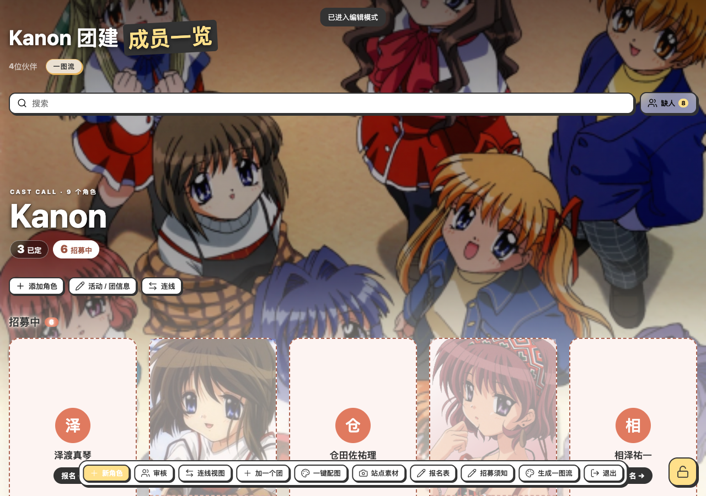
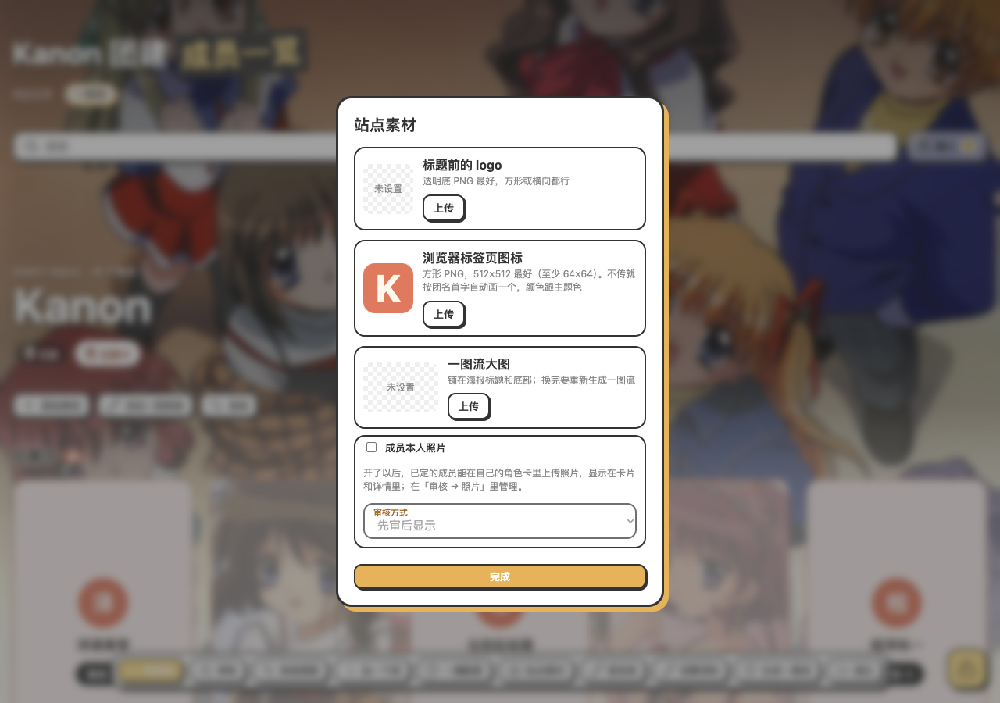

# 后台：建好站之后改东西

建站只有一次，之后都在网页上点：**右下角的锁 → 输管理密码 → 底部出现工具条**。
改完即时生效（图和一图流除外，见文末「什么时候要重新生成海报」），不用回到命令行。

*从左往右：新角色、审核、连线视图、加团、一键配图、站点素材、报名表、招募须知、生成一图流、退出。*

| 按钮 | 用来干什么 |
|---|---|
| **新角色 / 加一个团** | 名单不用回到命令行改，直接在这里加 |
| **审核** | 报名、留言、成员照片的通过 / 拒绝 |
| **连线视图** | 角色和 CN 连成关系图，人多了用来核对「谁出谁」 |
| **一键配图** | 批量重试没配上的封面和立绘 |
| **站点素材** | logo、标签页图标、一图流大图 |
| **例图** | 上传团长想拍的参考图，写图注、调顺序；显示在名册下面（见 `docs/config.md` 的 shots） |
| **报名表 / 招募须知** | 改报名字段、写招募要求（会显示在报名表和缺人看板） |
| **生成一图流** | 名册或图片改过之后重新出海报 |
| **退出** | 退出编辑模式，页面回到访客视角 |

---

## 改名册

- **改一个字**：点角色名或 CN 那一格，改完回车。改了角色名，已绑的立绘会跟着搬（`uploads/map.json` 里的键会一起改）。
- **加角色**：团卡上的「添加」，或工具条「新角色」。
- **加团**：工具条「新团」；单团页的工具条在信息区上方。
- **删角色 / 删团**：编辑角色 / 团信息面板里的「删除」，会先确认（删团会告诉你连带几个席位）。

名册每次保存都会在 `instance/backups/` 留一份快照（默认最近 300 份），改坏了可以找回上一份。

---

## 换图：三种来源

| 来源 | 怎么做 | 适合 |
|---|---|---|
| 自己上传 | 编辑角色 / 团时的「立绘 / 封面」一栏选文件 | 有自己拍的样片、修过的图 |
| 从 Bangumi / AniList 找 | 角色卡「找立绘」、团信息「在线找封面」 | 大多数情况，候选里挑一张 |
| 批量补 | 工具条「一键配图」 | 建站时断网、名字改过之后 |

**找图面板怎么读**：每张候选下面是来源和角色名，标「✓ 这部作品」的表示它出现在这个团的作品角色表里——优先选带这个标记的，同名角色不会配错。

面板里的缩略图是**服务器去取的**，不是你的浏览器直连图床。所以偶尔会看到灰块「缩略图没拉到」：那是服务器这条线路连不上 Bangumi 的图床（`lain.bgm.tv`，国内常见 DNS 污染），**跟名字对不对无关**。这时照样可以点一张试——保存时服务器会重新下载一次，成了就有图；一直不行就换一张，或用自己的图。

**宁可空着，也不配错图**：名字拿不准时系统不会乱猜，会列出候选给人点；名单里的写法（月宫亚由 / 月宮あゆ）也不需要改，比对时会自己转。

站点素材（logo、标签页图标、一图流大图）在工具条「站点素材」里：

*不传图标也会按团名首字自动画一个（图里那个 K）。传过的图会立刻替换，一图流大图换完要重新生成海报。*

---

## 审核报名、留言、照片

工具条「审核」，三个页签：

- **报名**：`通过` 才把 CN 写进名册、占掉那个席位；`拒绝` 保持空缺；已通过的点「撤回」会把席位空出来。
- **留言**：留言区设成「先审后发」时，这里是待审队列。
- **成员照片**：成员自己传的照片，通过后显示在角色卡和详情页；同一席位传新的会替换旧的。

报名表点了「通过」以后，页面上那个席位立刻从「招募中」变成「已定」，不需要刷新。

---

## 改报名表要填什么

工具条「报名表」。CN 和联系方式是固定的，其余（身高 / 年龄 / 性别 / 样片 / 所在城市…）都可以勾，每项选「选填」或「必填」，也能自己出题。

- **去掉某一项不会删掉已经收到的答案**，审核里照样能看到。
- 加一项立刻对**新报名**生效，已经在审的那条不受影响。
- 别把「样片」设成必填，除非招募真的需要——会让不少人直接放弃报名。

等价于改 `site.json` 的 `signup.fields`，格式见 [config.md](config.md#signup报名)。

---

## 写招募须知

工具条「招募须知」。四类条目，各自有默认位置和措辞：

| 类型 | 用来说什么 |
|---|---|
| **必须 / 卡什么** | 身高、服装、出勤要求这类硬条件 |
| **不接受** | 明确排除的情况（鸽子、代出、商拍……） |
| **提醒 / 风险** | 外景天气、妆造自理、费用分摊 |
| **补充说明** | 其他零碎 |

写好的须知会同时出现在**单团页**（折叠区）、**报名表**（提交前一眼看到）、**缺人看板**底部，不用三处各写一遍。

---

## 什么时候要重新生成海报

一图流**不会自动重建**：名册或图片改过以后，工具条上的「生成一图流」按钮会带一个「旧」字，点它才重出。

这么设计是有意的：每改一次名册就在你机器上开一次 Chrome，内存扛不住；而且「什么时候出海报」该由你决定（比如等这一批报名都审完再出）。

海报版式、手机上挑竖版、导出 JPG，见 [poster.md](poster.md)。

---

## 后台接口

想用脚本改、或者交给 AI，接口清单在 [AGENTS.md](../AGENTS.md) 的「后台接口」一节（需要登录 cookie）。
手动调用的例子和踩坑见 [troubleshooting.md](troubleshooting.md) 末尾。
