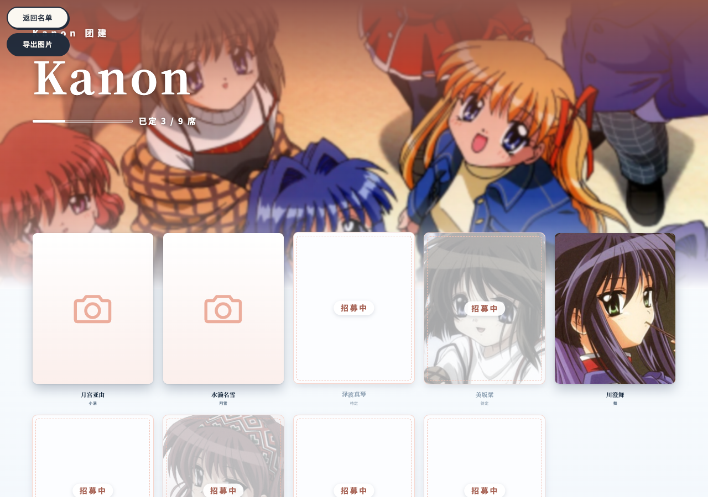
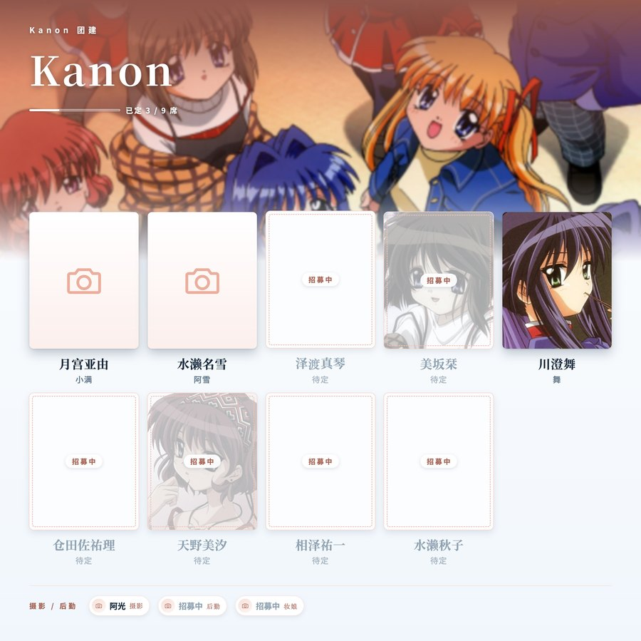

# 一图流（可选）

把名册排成一张大海报：网站上 `/poster/` 可以直接看（手机竖版、电脑宽版），也能导出 JPG 发群。

## 安装

核心服务只用标准库。海报要额外装：

```bash
python3 -m venv .venv-poster
.venv-poster/bin/pip install -r requirements-poster.txt
.venv-poster/bin/playwright install chromium
```

另外要有中文字体（海报用 Noto Sans / Serif CJK）：

- Debian / Ubuntu：`sudo apt install fonts-noto-cjk`
- Fedora：`sudo dnf install google-noto-sans-cjk-fonts google-noto-serif-cjk-fonts`
- macOS：系统自带的字体能显示，但要和设计稿一致，最好装 Noto CJK

然后在 `.env` 里告诉服务器用哪个 Python：

```ini
CASTCALL_POSTER_PYTHON=/path/to/castcall/.venv-poster/bin/python
```

按上面的命令把 venv 建在仓库根目录的 `.venv-poster/` 时，这一行可以不写，会自动使用。

## 长什么样

网页版（页眉的「一图流」入口打开的就是它），右上角有「导出图片」：



*手机上自动挑竖版，电脑上挑横版，同一个地址。*

导出 / 生成出来的 JPG（单团阵容版）：



*已定的角色显示立绘和 CN，招募中的留虚线框，最下面一行是工作组。*

## 生成

- **建站时**：`init.py` 和网页向导建完站、配完图会自动生成一次（`init.py --no-poster` 关掉）。
- **后台**：工具条点「生成一图流」，一两分钟后提示完成。抬头会出现「一图流」入口。名册或图片改过之后要再点一次——改过没重建时，这个按钮上会挂一个黄色的「旧」。
- **命令行**：

```bash
.venv-poster/bin/python poster/build.py                 # 多团：master + wide + portrait；单团：master + social + portrait
.venv-poster/bin/python poster/build.py social --group "示例作品 A"
```

产物在 `instance/poster/`：

| 文件 | 尺寸 | 用途 |
|---|---|---|
| `master.html` / `master.jpg` | 宽 2400，高度随人数 | 主海报，发群、存图（单团是一张「阵容长卷」，见下） |
| `portrait.html` | 宽 1200，高度随人数 | 手机网页版：一个团占满一行、卡片 2 列（屏幕宽于 640 时 5 席以上的团自动改 3 列） |
| `wide.html` / `wide.jpg` | 宽 3840，多列 | 宽版，电脑、投屏（只有多团） |
| `social.jpg` | 宽 1080，4:5 竖图（1080×1343） | 社交平台配图（单团阵容的手机截图版，小红书 / 微博的竖图比例） |

**单团不用多团那套卡片成组布局。** 多团是「一个团 = 一张白卡 + 封面标题条 + 卡片网格」，只有一个团时那张白卡就是整张图，看着像把多团版删到只剩一团。单团的 master / portrait / social 都走 `lineup()`：封面铺满顶部当底，标题和「已定 N / M 席」进度条压在画上；立绘从画里站出来、压住封面下沿，名字直接排在纸面上（没有卡框）；空席位是虚线框 +「招募中」；工作组在底部排成一行署名；有日期地点时最底下一行写上，没有就不画。

`/poster/` 会按屏幕形状挑一张：**竖屏（高比宽大）看 `portrait`**，宽屏看 `wide`，其余看 `master`。以前只有 master/wide，单团还写死 master——2400×1255 的横条在竖屏里按宽缩到 390 只剩 204 高，网页再竖直居中，卡片看着像被挤到屏幕下半截。竖版把画布收窄一半、卡片改成 2 列，字大一倍、高度铺满一屏。某个版式文件还没生成时自动回落到 `master`，不会 404。

**「导出图片」下的是你正在看的那一版**：竖版页面给 `portrait.jpg`，宽版给 `wide.jpg`，其余给 `master.jpg`。以前按钮不认页面、只认 wide，于是在竖版页面上点导出，下到的还是那张横条——看着就像改了没生效。想要横的就开 `master.html` 再导出。

名册改了不会自动重建，要再点一次（按钮上会挂「旧」提醒你）。

**还没定人的席位也上海报**，画成虚线框 + 压暗的立绘 + 「招募中」。以前这些席位整张卡都不画，于是「5 席定 2 席」的团只剩两张卡，整张图空掉一半。现在标题条上的「2/5 人」和卡片的虚线就是进度，一眼看得出还在招人。

**工作组（名册里 `kind: "crew"` 的组，比如「摄影 / 后勤」）不做立绘卡**。他们没有角色立绘，空出来的图位里摆一个相机只是占位符。海报上给他们做**名牌**：相机徽章 + 名字 + 职务。`master` 里竖着排、整段占 3 列（只占 2 列时「摄影 / 后勤」会顶到右边的人数上）；竖版和宽版里横过来，一行一个人。真给某个席位传了工作照，那一张仍按照片卡画。

**没有背景图也能看**：后台没传过「海报底图」（`site.json` 的 `poster.hero`）时，程序拿第一个团的封面**铺满整张画布**当背景（跟网页首页一样，看得见画），上面只盖一层很淡的白霜，卡片区仍是白的。传了自己的高清底图就按你的来。

封面原图通常只有 400–600px 宽，铺到 2400 是放大，所以底图带一点模糊（`master` 8px / `wide` 26px，宽版铺得更狠）；竖版画布 1200×3500，封面按原比例摆在顶上、往下化开，下半截交给同一张图糊出来的色场，中间没有硬边。标题带里那层同图的影子已经去掉——底图就在下面，再画一遍只会多出一块「更糊的矩形」。

## 名字太长怎么办

角色名和成员名放不下时会自动收字号，最多收到原大小的 45%。所以在手机上也不会被切掉最后一个字——构建时按文字**实际宽度**量的，网页版打开时还会按你手机自己的字体再量一遍（iPhone 没有 Noto，用的是系统宋体，宽窄不一样）。

超过这个限度（大概 12 个汉字以上的角色名）就真的放不下了，海报上会被裁掉尾巴。`instance/logs/poster.log` 里会记一行「名字太长，字号已经收到下限」。这种名字建议在名册里改短，或者用简称。

## 让封面裁得好看

每个团的标题条会铺这个团的封面。条很扁，程序要知道封面上哪块区域必须完整露出（通常是人物从眉毛到下巴）。在名册里给团加：

```json
"cover_focus":[0.1,0.3,0.9,0.5]
```

四个数依次是左、上、右、下，都是占封面宽或高的比例（0–1）。上面这个例子的意思是：横向 10%–90%、纵向 30%–50% 的区域要完整露出。没写就用 `[0.1,0.1,0.9,0.5]`。

调法：生成一次，看 `/poster/` 上这个团的标题条，脸被切了就调这四个数，再生成。

## 其他素材

- **立绘**：在后台上传。海报会自动裁成 4:5 半身卡，没有立绘的显示相机图标。
- **标题大图**：放一张图到 `instance/uploads/brand/`，在 `site.json` 写 `"poster":{"hero":"文件名"}`。
- **logo**：`brand.logo`，同上。

## 服务器上跑不了 Chrome？

在自己电脑上生成，再把 `instance/poster/` 整个目录传到服务器同样的位置。网页版引用的是相对网站的地址，换台机器也能看。
