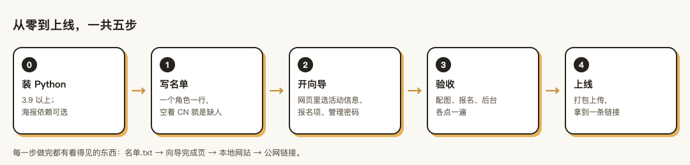
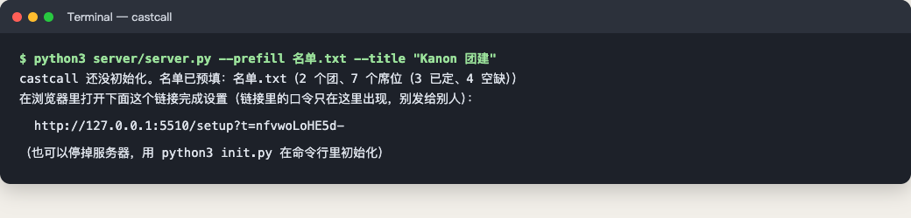
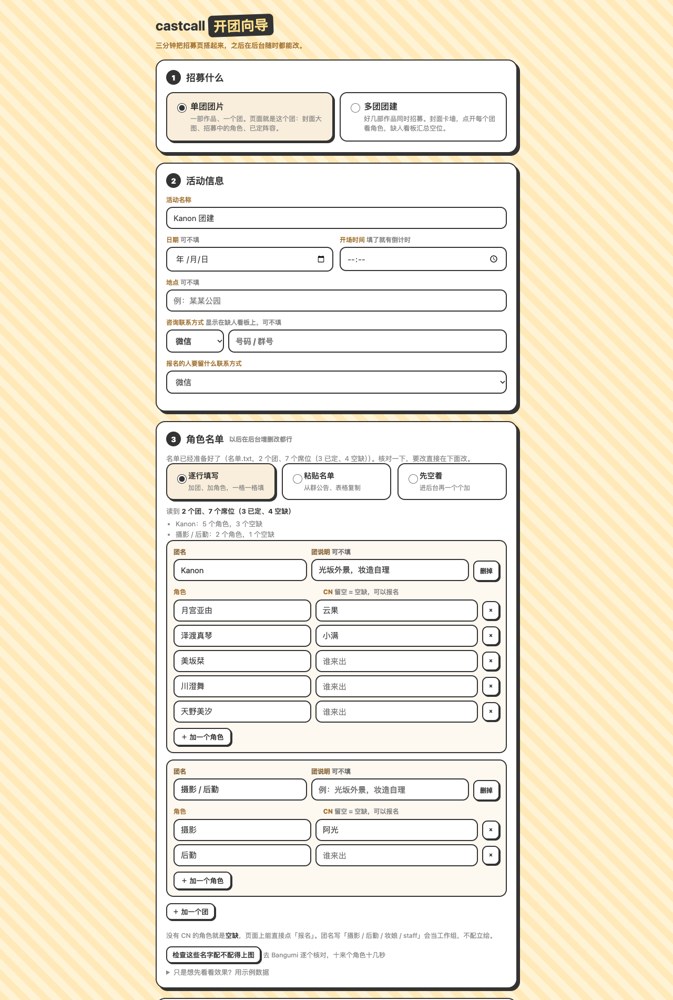
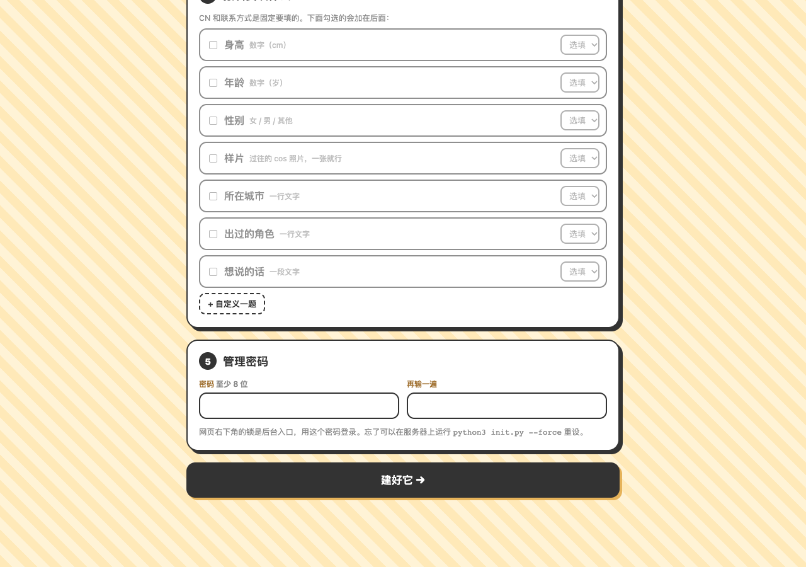
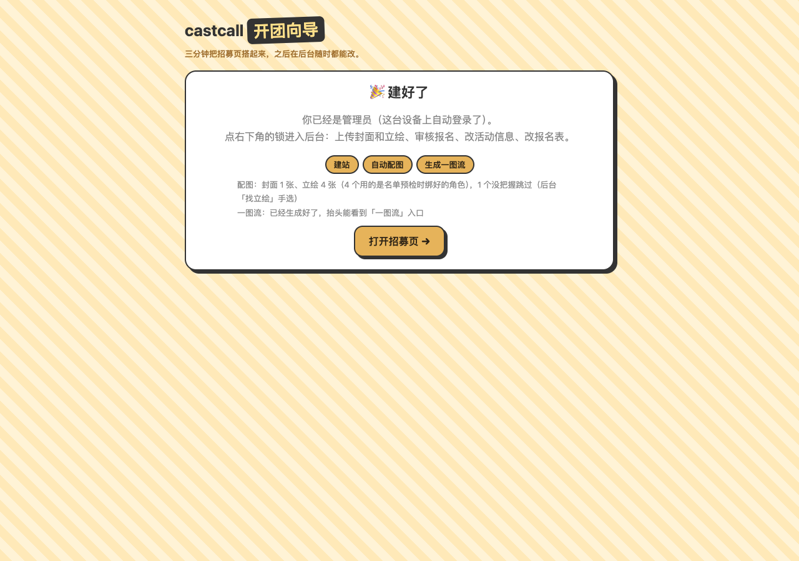
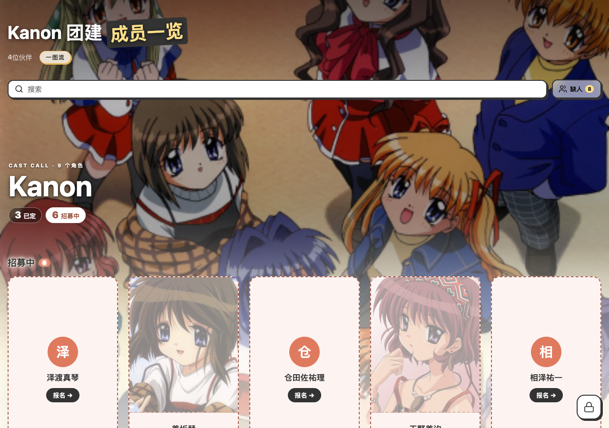
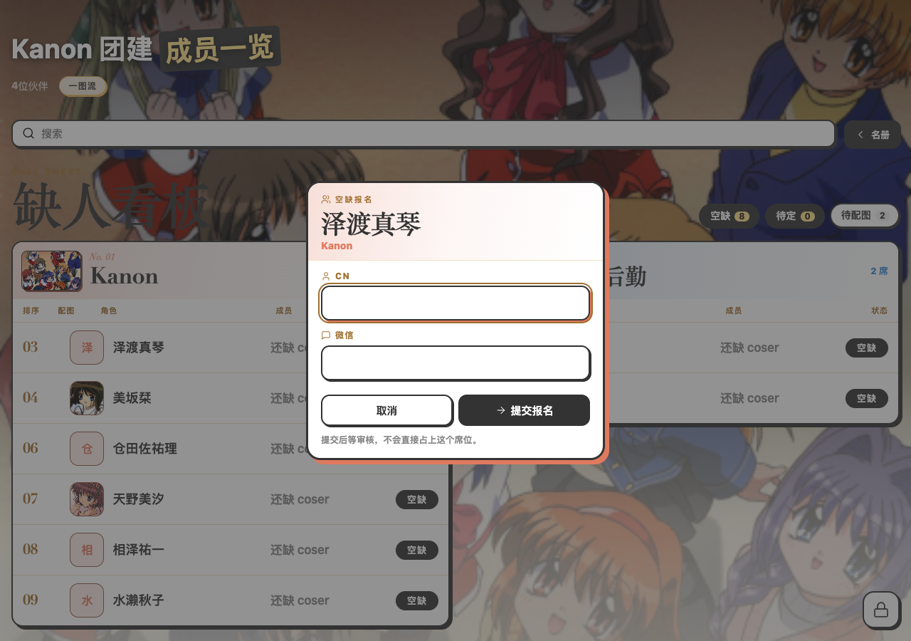
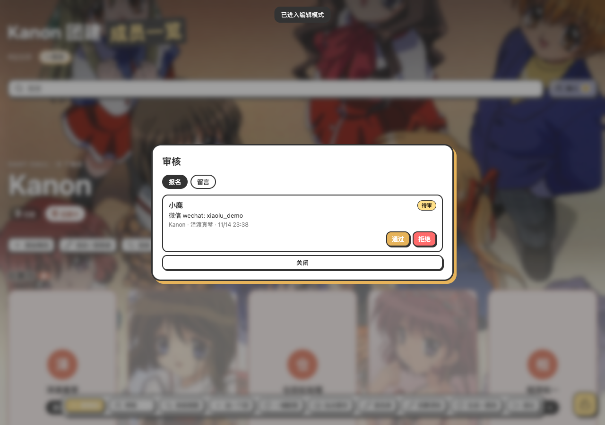

# 手把手：从零到上线，每一屏长什么样

这是 [README](../README.md) 的展开版：**同一条路，配上真实截图**，讲清每一格填什么、不填会怎样、为什么这么设计。
第一次自己动手，照着走十几分钟。

| 你要的是 | 去哪 |
|---|---|
| 只要命令，不要截图 | [quickstart.md](quickstart.md)（同一套流程的命令版） |
| 卡在某一屏 | [troubleshooting.md](troubleshooting.md)（症状 → 原因 → 办法） |
| 不想自己点，交给 AI | [README 开头](../README.md#最快一句话让-ai-帮你部署) |
| 建好之后日常改东西 | [admin.md](admin.md)（后台每个按钮） |

五步走完，每一步都有看得见的东西：**名单.txt → 终端里的验证码 → 向导完成页 → 本地网站 → 公网链接**。



---

## 第 0 步：装环境

只要 **Python 3.9 以上**。打开终端，先确认一下：

```bash
python3 --version          # 看到 Python 3.9.x 以上就行
git clone https://github.com/RichardLiuda/castcall.git
cd castcall
```

macOS / Linux / Windows 都可以。核心服务**不需要 pip install 任何东西**。

只有「一图流海报」用到两个额外依赖，建议装上（不装也能建站，只是跳过海报，以后补装再点一次「生成一图流」即可）：

```bash
python3 -m venv .venv-poster
.venv-poster/bin/pip install -r requirements-poster.txt
.venv-poster/bin/playwright install chromium
# Linux 服务器还要中文字体：sudo apt install fonts-noto-cjk
```

仓库里有 `.venv-poster/` 就会被自动使用，不用改配置。Windows 上把 `.venv-poster/bin/` 换成 `.venv-poster/Scripts/`。

---

## 第 1 步：写一份名单

新建一个 `名单.txt`，**一行一个角色**，前面写角色名，后面写已经定下来的 CN；**只有角色名没有 CN 的，就是还在招募的空位**：

```
## Kanon                      ← 一个「##」开一个团；只有一部作品也建议写
> 光坂外景，妆造自理          ← 「>」开头是这团的说明
月宫亚由 云果                 ← 角色 + CN（空格 / Tab / 冒号 / 竖线分隔都行）
泽渡真琴 小满
美坂栞                       ← 没有 CN = 空缺，可以报名
川澄舞
## 摄影 / 后勤                ← 团名带「摄影 / 后勤 / 妆娘 / staff」会当工作组，不配立绘
摄影 阿光
后勤                         ← 工作组里也能留空位招人
```

名单从哪来，三选一：

| 你手上有 | 怎么做 |
|---|---|
| 群公告 / 表格 / Excel | 按上面的格式粘贴成文本；CSV 也行，表头写 `团,角色,CN` |
| 只有作品名 | `python3 server/artsearch.py roster Kanon -o 名单.txt`，拉一份该作品的角色表（全空缺）再改 |
| 还没想好 | 不用准备文件，向导里选「先空着」，建好后在后台一个个加 |

**建站前建议先核一次名字**（不下载图片、不建站，只是看看角色名在作品角色表里对不对得上）：

```bash
python3 server/artsearch.py names 名单.txt
```

每个名字后面会跟一个标记：`✓` 能配上图；`⚠` 只差一个字，多半是写错了；`✗` 作品里没这个名字，下面会列出候选。**这一步能提前发现「月宫亚由」写成「月宮あゆ」这类问题**——建完站才发现，就得去后台一张张手选了。核对过的名字会存成角色 id，后面配图不再靠搜索碰运气。

---

## 第 2 步：启动，拿到向导链接

在仓库目录里执行（`--title` 里的活动名换成你自己的）：

```bash
python3 server/server.py --prefill 名单.txt --title "Kanon 团建"
```

终端会打印这样一段：



*图 1 · 真实终端输出。六位数字是这次建站的验证码，只在这里出现。*

**两种进法，用哪种都行**：

- 复制 `http://127.0.0.1:5510/setup?t=…` 这一整条打开——链接末尾已经带着验证码，不用再输；
- 或者只打开 `http://127.0.0.1:5510/setup`，页面会要你输那 **6 位数字**（图里是 `070741`，以你终端为准），输满六位自动验证。

注意三点：

1. **验证码别发给别人**——谁先拿到谁就能设管理密码。
2. 输错几次会被锁 10 分钟（防止有人对着六位数慢慢试）；重启服务器会换一个新的，重新看一下终端就行。
3. **这个终端窗口先别关**，关了服务就停了；向导填到一半被关掉，用同一条命令重启，验证码不变，可以接着填。

没有名单的话，直接 `python3 server/server.py`，在向导里逐行填、粘贴，或选「先空着」都一样。

---

## 第 3 步：在网页向导里填五项

打开链接后是这张表，**名单和活动名已经替你填好了**，核对一下就行：



*图 2 · 向导第 1～3 步。第 3 步的名单是表格：一个团一张卡，一行一个角色。往下滚动还有「报名要填什么」和「管理密码」。*



*图 3 · 向导第 4～5 步，最下面那个深色按钮就是「建好它 →」。*

第 3 步的名单有三条路，选一条就行：

| 怎么填 | 适合 |
|---|---|
| **逐行填写**（默认） | 边想边加：点「＋ 加一个角色」「＋ 加一个团」，格子填完就成 |
| **粘贴名单** | 手上已有群公告 / 表格：整段贴进去（格式见[第 1 步](#第-1-步写一份名单)） |
| **先空着** | 只想先看看页面长什么样，进后台再一个个加 |

表格里没有填 CN 的行就是**空缺**，页面上能直接点「报名」；团名写「摄影 / 后勤 / 妆娘 / staff」会自动当工作组，不配立绘。

逐个说明每一项该填什么、不填会怎样：

| 位置 | 填什么 | 不填 / 选错会怎样 |
|---|---|---|
| **1 招募什么** | 单团团片 / 多团团建。名单只有一个团时默认「单团」 | 选错了也能在后台改；单团是整页阵容，多团是封面卡墙 |
| **2 活动名称** | 显示在页眉和海报上，比如「Kanon 团建」 | 必填 |
| **2 日期 / 开场时间** | 填了开场时间，页面顶部会出现倒计时 | 留空就完全不显示这一段（**不会替你编一个日期**） |
| **2 地点 / 咨询联系方式** | 显示在缺人看板上，方便路人问 | 留空就不显示，别填没确定的信息 |
| **2 报名联系方式** | 报名表里那一栏叫什么：微信 / QQ / 邮箱 / 手机号 | 只影响表头文字 |
| **3 角色名单** | 一个团一张卡：团名、团说明、每行「角色 + CN」；点「＋」加行加团，右侧「×」删行 | 团名留空会拿活动名顶上；没填 CN 的行照样保存成「空缺」 |
| **3 检查名字** | 点一下，去作品角色表逐个核对 | 断网也能建站，只是配图可能少几张 |
| **4 报名要填什么** | 勾身高 / 年龄 / 性别 / 样片 / 所在城市…，每项选「选填」或「必填」，也能自己出题 | CN 和联系方式固定要填；其余不勾就不会出现在报名表 |
| **5 管理密码** | 至少 8 位，输两遍 | **记牢**：右下角的锁靠它进后台；忘了可以在服务器上跑 `python3 init.py --force` 重设 |

> 只是想先看看效果？向导第 3 步里有个「只是想先看看效果？用示例数据」，展开选一份即可，不用自己写名单。

确认无误，点最下面的 **「建好它 →」**。

---

## 第 4 步：看完成页

提交后页面变成这样，三个格子会依次亮起来：



*图 4 · 三格全亮 = 全做完了。下面两行小字是配图和一图流的结果。*

| 格子 | 做了什么 | 没成功怎么办 |
|---|---|---|
| **建站** | 写出 `instance/` 下的名册、配置、密码 | 失败会在按钮下方红字说明原因 |
| **自动配图** | 给每个团找封面、给每个角色找立绘；只配有把握的，其余跳过 | 断网 / 名字对不上会跳过几个，页面写清原因；进后台点「找立绘」手选，或「一键配图」重试 |
| **生成一图流** | 生成网页版海报 + JPG | 没装第 0 步的可选依赖会跳过；装好后在后台点「生成一图流」补上 |

**配图和海报失败都不会让建站失败**，网站已经能用了。完成后这台设备会自动登录成管理员，点「打开招募页 →」就能看。

> 海报是后台慢慢生成的，完成页会继续等它落盘（一两分钟）。三格全亮才算真的好了；如果等太久，去 `instance/logs/poster.log` 看一眼。

---

## 第 5 步：验收，四件事点一遍

服务已经在跑，打开 **http://127.0.0.1:5510/**。照着这份清单点：

1. **名册对不对**：团名、角色、CN 和你写的名单一致；一部作品 + 摄影后勤应该是一整页，不是两张卡。
2. **图片在不在**：封面、立绘配上了；页眉有「一图流」入口（没装可选依赖的话没有）。
3. **报名能不能点**：空缺角色上点「报名 →」，能打开报名表。
4. **后台进不进得去**：点右下角的锁，输刚才设的密码，能看到编辑工具条。

页面上还有这些现成的东西：搜索框（按角色或 CN 找人）、「缺人」看板（所有空位按团列出）、留言区、倒计时（填了开场时间才有）、成员照片（可选，审核后显示在角色卡上）。

建好之后的样子：



*图 5 · 单团页：顶部是封面，下面「招募中」的席位可以直接点「报名 →」，右下角的锁是后台入口。*

---

## 第 6 步：报名和审核是怎么走的

访客在空缺席位上点「报名 →」，填 CN 和联系方式（以及你勾过的额外题目）：



*图 6 · 提交后会提示「已提交，等审核」——**不会直接占座**。*

团长这边点右下角的锁 → 工具条「审核」→「报名」，就能看到待审的那条：



*图 7 · 点「通过」才会把 CN 写进名册、占掉那个席位；点「拒绝」则保持空缺。*

这样做的好处：别人填错、灌水、一个人报好几个角色，都由你把关。留言区也能设成「先审后发」，同一套面板里切到「留言」页签即可。

---

## 接下来

建站只有一次，之后都是「改东西」。下面三篇各管一摊：

| 想做什么 | 看 |
|---|---|
| 改名单、换图、改报名字段、写招募须知、换 logo / 标签页图标 | [admin.md](admin.md) |
| 出一图流海报、换版式、手机上挑竖版 | [poster.md](poster.md) |
| 把链接发给别人（托管平台 / 自己的服务器） | [hosting.md](hosting.md) / [deploy.md](deploy.md) |
| 备份、迁移、线上和本地是两份数据怎么办 | [data.md](data.md) |
| 只想用命令行一次做完（没有浏览器 / 让 AI 全权代办） | [quickstart.md](quickstart.md) |
